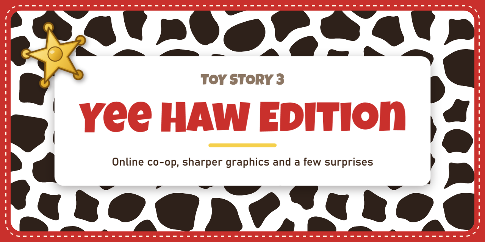

<p align="center">
  
</p>

<p align="center">
  <b>Online co-op, better graphics and restored content for <i>Toy Story 3</i> on Steam.</b><br>
  An unofficial fan mod. No game files are changed or included.
</p>

---

## What it does

### 🤠 Online co-op over Steam
- **Play the whole game together online**, story levels and the Toy Box, with a friend on another PC.
- **Drop-in:** your friend can join while you're already playing. Both games reload your level together and
  carry on from there with your save.
- **Steam invites:** hold **Back + Y** while you wait to open Steam's invite dialog, or your friend uses
  *Join Game* from your name in their friends list.
- **Full screen each:** each player sees their own character full screen instead of a split screen.
- **Clear messages:** if your two games are set up differently, both screens say exactly which setting differs
  and where to change it.
- Both games run in perfect step (lockstep), and small differences are repaired on the fly without reloading.

### ✨ Graphics
- SMAA anti-aliasing (with the HUD kept sharp), up to 16x texture filtering.
- Sun shadows up to 4x sharper, with soft edges, no flickering triangles on cliffs and no hard line where the
  near shadows end. Small props cast shadows at every distance.
- Characters, objects and the world stay detailed up to 8-16x farther away.
- Full-resolution reflections, glow and light shafts, and cleaner ambient shadows.
- Presets from *Game* to *Yee Haw!*, or set each option yourself.

### 🎬 Restored content
- **Randy Newman's vocal "You've Got a Friend in Me"** on the story board and in Al's Toy Barn, as in the 2010
  PC game. It plays from your own copy of the 2010 game; without one you hear the usual instrumental.
- **Hidden and Wii-only levels:** Andy's Basement, Buzz Flight, the train stub, Trendy Town, the Skate Park and
  the Shooting Gallery, now with their sounds, dialogue and working menu buttons.
- **The 2010 PC game's bug fixes** for aiming after a jump, the aiming reticle, ball throws, TNT in water,
  co-op ground pounds and Zurgbots falling out of the world.
- Content the game ships but never unlocks: the Skate Park module and two car bodies (from the debug menu).

### 🛠️ Debug menu
Hold **LB + RB** and press **Y** (or **F1**) in game:
- level select (including the hidden and developer levels), teleport, cheats, god mode, game speed;
- a **free camera** that draws the whole scene, and a wider field of view;
- coins, unlocks, and a lock editor for anything behind a lock;
- **test save mode:** a separate copy of your save with Steam achievements switched off, plus a one-press
  *make this save 100%* for trying things out.

In online co-op the cheats are locked; level select, progress and teleport act for both players at once.

### 🎛️ Settings launcher
A small settings app in Jessie's colours: pick solo or online co-op, your partner, graphics presets and the
extras, then start the game.

## Requirements

- Windows 10 or 11 (64-bit).
- *Toy Story 3* on Steam (app 4049180).
- A controller: Xbox-style, or any controller through Steam Input. Online, keyboard and mouse are switched off
  on purpose (only the controllers are kept in step).
- The settings launcher needs the [.NET 8 Desktop Runtime](https://dotnet.microsoft.com/download/dotnet/8.0).
- Optional: the original 2010 PC release of *Toy Story 3* installed, for the vocal theme.

## Installing

1. Close the game.
2. Open the game folder: in Steam, right-click *Toy Story 3* > **Manage** > **Browse local files**.
3. Copy these into that folder (next to `Toy Story 3 Complete Edition.exe`):
   - `xinput1_4.dll`, the mod itself;
   - `xinput_harness.ini`, its settings;
   - `YeeHawLauncher.exe`, the settings launcher (optional: you can also edit the ini by hand).
4. Start the game from Steam as usual, or from the launcher's **Play** button.

The mod loads because Windows looks for `xinput1_4.dll` in the game's folder first. To remove it, delete
those files. Steam's *Verify integrity of game files* leaves extra files alone, so it won't remove them for you.

Before playing on your real save, it's worth backing up
`%APPDATA%\Disney\Toy Story 3 Complete Edition\savedata`.

## Playing online

**Both players need the same mod build**, and these settings must match (the launcher marks them, and the game
tells you if they don't): input delay, full screen each, drop-in, the detail distances, *keep small objects far
away*, the Wii-only levels and the 2010 script fixes. Everything else, like anti-aliasing or shadow quality,
can differ.

**The host (player 1)**
1. In the launcher's *Partner Up* tab, choose **Online co-op**, **Host**, and enter your friend's Steam ID
   (the 17-digit number in their Steam profile's address). Or in the ini: `mode=netplay`, `role=host`,
   `peer_steamid=...`.
2. Start the game and play. The banner at the top shows the connection.
3. To invite your friend, hold **Back + Y** while you're waiting for them.

**The friend (player 2)**
1. Set **Online co-op** and **Join**, with the host's Steam ID (`role=client`).
2. Accept the host's invite, or use **Join Game** from their name in your friends list, or just start the game.
3. Don't press anything while the games load together. When the level is loaded, press **Start** to join.

Player 2 plays on the host's save; theirs is backed up first and isn't changed. If the connection drops,
both of you carry on alone, and the friend can simply join again.

## Known issues

- Very rarely, a camera cut shows one frame without sun shadows.
- The Skate Park can't be bought in the Toy Barn yet; open it from the debug menu instead.
- The Wii-only levels were never finished for this version: expect rough edges.
- Two players for now.

## Building from source

Visual Studio 2022 (C++ desktop workload) and, for the launcher, the .NET 8 SDK.

```
build.cmd                              builds the mod and installs it into the game folder
build.cmd uninstall                    removes it again
dotnet build -c Release launcher       builds the settings launcher
```

`docs/DEVELOPER.md` is the developer guide: how the mod keeps two PCs in step, the record/replay tools,
logs, and every setting in detail.

## Licence

The mod's code is free software under the [GNU General Public License v3.0](LICENSE): you can use, change and
share it, and anything you build from it and share must stay open source under the same licence. The parts
below keep their own licences.

## Credits

- Made by [SadTransGirl](https://github.com/SadTransGirl).
- [SMAA](https://github.com/iryoku/smaa) by Jorge Jimenez et al., MIT licence (`third_party/smaa_71c806a`).
- Fonts in the launcher: *Luckiest Guy* by Astigmatic (Apache 2.0) and *Rope MF* (freeware); their licences
  are in `launcher/Fonts`.

*Toy Story 3* and its characters belong to Disney and Pixar. This is an unofficial fan project, not affiliated
with or endorsed by Disney, Pixar or the game's developers. It ships no game files, art or audio: it changes
the game in memory while it runs, on your own copy.
